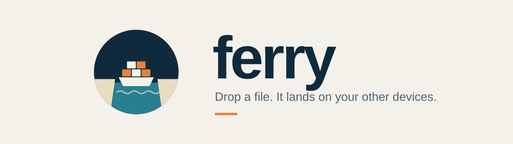

<p align="center">
  <picture>
    <source media="(prefers-color-scheme: dark)" srcset="assets/banner-dark.svg">
    
  </picture>
</p>

<p align="center">
  Move files between your browser and your Android phone with no cables, accounts or email-to-self.<br>
  Dock each device once, then drop a file and pick where it goes.
</p>

---

## How it works

1. **Start a fleet.** Open ferry in a browser. That browser becomes your first dock.
2. **Dock your phone.** On the web, open **Docks › Show boarding code**, then scan the QR with your phone's camera or type the 6-digit code into the app. You only do this once per device.
3. **Ferry files.** Drop files on the web page, or use **Share › ferry** on Android, then tick the destinations.

| Word | Meaning |
|---|---|
| Dock | a paired device |
| Boarding code | the one-time code that docks a device (5 min, single use) |
| Ferry | to send |
| Arrivals / Departures | received / sent |
| In port · Anchored · Away | online · Android in the background · browser tab closed |

**Delivery rules**
- Files wait on the server for up to 24h and are deleted as soon as every destination has them.
- Android receives in the background. It's instant while the app is open, otherwise it checks every 15 min.
- A browser receives while a ferry tab is open, even in the background.
- Each device chooses where its arrivals land:
  - Android: Settings › Arrivals land in.
  - Chrome or Edge: Docks › Change.
  - Other browsers use their normal downloads folder.

**Light / dark:** both apps follow the system by default.
- On the web, the button in the header (and on the welcome screen) switches between **Auto → Light → Dark**.
- On Android 12+, use Settings › Appearance.

## Install

The server is a single binary with the web app built in.

```sh
# Linux / macOS
curl -fsSL https://raw.githubusercontent.com/manosriram/ferry/main/install.sh | sh

# Windows (PowerShell)
irm https://raw.githubusercontent.com/manosriram/ferry/main/install.ps1 | iex
```

The script downloads the right binary for your OS and CPU from the latest release, checks it against `SHA256SUMS`, and installs it:
- Linux / macOS: `/usr/local/bin` (it uses sudo if needed), or `~/.local/bin` if sudo isn't available.
- Windows: `%LOCALAPPDATA%\ferry`, which it adds to your PATH.

Then run `ferry -data ~/.local/share/ferry` and open http://localhost:8080. Pin a version with `FERRY_VERSION=v0.2.0`, or pick the folder with `FERRY_BIN_DIR=…`.

## Repo

```
server/   Go API + live events (SSE), SQLite, files on local disk; serves web/
web/      plain HTML/CSS/JS, no build step
android/  Kotlin app: docking, share-sheet target, background arrivals, save folder
assets/   README banner
```

## Run it

```sh
cd server
go run . -addr :8080 -data ./data -web ../web     # open http://localhost:8080
go test ./...                                     # full dock → ferry → ack flow
```

| Flag | Default | |
|---|---|---|
| `-addr` | `:8080` | listen address |
| `-data` | `./data` | SQLite database + stored files |
| `-web` | `../web` | web app directory (ignored by release binaries, which have the UI built in) |
| `-max-mb` | `2048` | largest file accepted |

Android: open `android/` in Android Studio, or run `./gradlew installDebug`. The emulator reaches your machine at `http://10.0.2.2:8080`.

## Releases

`.github/workflows/release.yml` builds on every PR and on manual runs (the results are attached to the run as artifacts).
Pushing a tag `vX.Y.Z` also publishes a GitHub Release with:

- `ferry-<os>-<arch>` server binaries for linux, macOS and windows, with the web UI built in (`go build -tags bundle`), so you just run `./ferry-linux-amd64 -data ./data`
- `ferry-X.Y.Z.apk`, a release build that is shrunk and signed
- `SHA256SUMS`

APK signing needs these repo secrets. Without them the APK is built unsigned:

| Secret | Value |
|---|---|
| `ANDROID_KEYSTORE_BASE64` | `base64 -i release.jks` |
| `ANDROID_KEYSTORE_PASSWORD` | keystore password |
| `ANDROID_KEY_ALIAS` | key alias |
| `ANDROID_KEY_PASSWORD` | key password |

Make a keystore once and keep it safe, because you can't publish updates to the app without it:
`keytool -genkeypair -v -keystore release.jks -alias ferry -keyalg RSA -keysize 4096 -validity 10000`

## API

| | |
|---|---|
| `POST /api/fleet` `{name, platform}` | start a fleet, returns `{device_id, token}` |
| `POST /api/dock/code` | issue a boarding code |
| `POST /api/dock/claim` `{code, name, platform}` | dock with a code, returns `{device_id, token}` |
| `GET /api/qr?code=` | boarding QR (PNG), encodes `ferry://dock?server=…&code=…` |
| `GET /api/docks` · `PATCH /api/docks/me` · `DELETE /api/docks/{id}` | list, rename / set save label, undock |
| `POST /api/crossings?name=&to=id,id` | upload (raw body) to destinations |
| `GET /api/crossings[?box=out]` | arrivals, or departures with per-destination status |
| `GET /api/crossings/{id}/file` · `POST /api/crossings/{id}/ack` | download, confirm landed |
| `GET /api/events` | Server-Sent Events: `arrival`, `departure`, `docks`, `undocked` |

Auth: `Authorization: Bearer <token>` (or `?token=` for EventSource and download links).

## Not yet

- Push (FCM) for instant Android arrivals while the app is closed
- Web push for a closed tab
- Object storage (S3/R2) and end-to-end encryption
- In-app QR scanner (the system camera handles it through the `ferry://` link)
